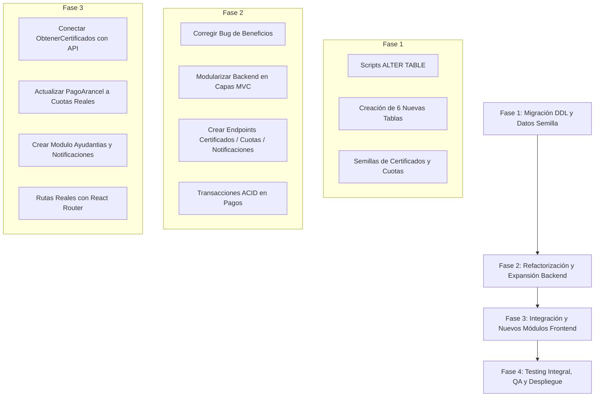

# INFORME DE CONSULTORÍA TÉCNICA Y AUDITORÍA DE SOFTWARE
## PROYECTO: PORTAL DE AUTOSERVICIO INSTITUCIONAL (UTFSM)

---

| **Ficha Técnica de Consultoría** | **Detalle** |
| :--- | :--- |
| **Cliente / Institución** | Universidad Técnica Federico Santa María (UTFSM) |
| **Asignatura / Programa** | INF225 — Ingeniería de Software (2° Semestre / 2026) |
| **Equipo Ejecutor** | Startup Estudiantil **MEJORA** (Grupo 5) |
| **Integrantes** | Vicente Rodríguez, Isidora Riquelme, Daniel Ricci, Ariadna Marquez, Gabriel Toro, Javier Gana |
| **Tutor Asignado** | Isidora Villegas |
| **Tipo de Auditoría** | Consultoría Técnica 360°: Arquitectura, Base de Datos, Calidad de Código, Integración y Documentación |
| **Fecha de Emisión** | Octubre 2026 |
| **Versión del Informe** | 1.0 — Final |

---

## 1. RESUMEN EJECUTIVO

El presente informe contiene una auditoría exhaustiva e independiente realizada sobre el repositorio y la arquitectura del **Portal de Autoservicio Institucional de la Universidad Técnica Federico Santa María**. El proyecto se encuentra actualmente en una fase crítica de transición: fue recibido como base legada (*legacy codebase*) proveniente del curso precedente INF236 ("Análisis y Diseño de Software") y está siendo asumido por el equipo **MEJORA** en el marco de la asignatura INF225 ("Ingeniería de Software").

### Diagnóstico Global del Sistema

| Dimensión Evaluada | Puntuación (1-10) | Estado / Diagnóstico Primario |
| :--- | :---: | :--- |
| **Arquitectura de Software** | **5.5 / 10** | Monolito desacoplado de 3 capas. Existe una desalineación severa entre lo declarado (supuestos "microservicios" y "MVC") y la implementación real (archivo plano monolítico en backend y enrutamiento simulado por estado en frontend). |
| **Base de Datos y Modelo ER** | **6.0 / 10** | Esquema SQL funcional para las operaciones básicas iniciales, pero altamente desincronizado con el backend y con módulos huérfanos en la interfaz gráfica (certificados sin persistencia). |
| **Calidad de Código y Bugs** | **4.0 / 10** | Se detectaron **fallos críticos de ejecución (Error 500)** en producción/runtime en el módulo de Beneficios, campos SQL omitidos que anulan requerimientos de negocio, y código muerto (*dead code*). |
| **Seguridad de la Información** | **3.0 / 10** | Almacenamiento de contraseñas en texto plano sin cifrar (*plaintext*), ausencia total de tokens de sesión (JWT) o cookies seguras, y endpoints administrativos completamente desprotegidos a nivel de API. |
| **Integración Frontend - Backend** | **5.0 / 10** | Acoplamiento rígido con URLs duras (`http://localhost:3000`), ausencia de capas de abstracción de red y consumo directo de endpoints sin contratos formales de datos (DTOs). |
| **Documentación y Gobierno** | **4.5 / 10** | Reglas de estilo documentadas en un lenguaje ajeno al proyecto (Python en lugar de JS/TS) y `README.md` desactualizado con afirmaciones técnicas inexactas. |

El sistema cuenta con una base visual moderna y funcional, pero requiere una **intervención técnica prioritaria** para estabilizar las fallas existentes antes de abordar con éxito la ampliación hacia el nuevo modelo relacional propuesto.

---

## 2. PUNTO 1: ANÁLISIS DE LA CARPETA DE MEMORIA Y CONTEXTO DEL PROYECTO

### 2.1. Contexto Académico y Dinámica de Startup ("MEJORA")
De acuerdo con la documentación en `Memoria/Memoria.md`, el equipo opera bajo el rol de una startup universitaria denominada **MEJORA** en el ramo INF225 de la UTFSM. El desafío operativo consiste en:
1. Recibir un proyecto heredado (empezado en INF236 por un equipo previo, Grupo 2).
2. Enfrentar una dinámica de rotación de personal (traspaso de integrantes entre grupos, dejando enlaces mínimos de continuidad).
3. Levantar historias de usuario, subsanar la deuda técnica acumulada e implementar módulos inconclusos para el portal de autoservicio de la universidad.

### 2.2. Auditoría de Estilo: La Inconsistencia Python vs. JavaScript/TypeScript
Al revisar detalladamente `Memoria/Memoria.md` (líneas 3 a 106), se constata una **inconsistencia metodológica y de gobierno técnico crítica**:
* **El Documento de Memoria prescribe reglas de código y ejemplos basados íntegramente en Python**:
  * Ejemplo de funciones: `def innitUDP(host = "0.0.0.0", port = 9001):` (líneas 23-24) y `def leerHistorial():` (línea 36).
  * Ejemplo de clases: `class InfoRonda:` (línea 55) y `class Servidor:` (línea 83), con atributos de sincronización de hilos como `threading.Semaphore(8)` y `threading.Lock()`.
  * Se solicita comentar cada función y clase con bloques textuales:
    ```
    # -------------------Funcion----------------------
    # ------------------Parametros-------------------
    # ------------------Return-----------------------
    ```
* **La Realidad Técnica del Proyecto**:
  * El backend está escrito en **Node.js (JavaScript CommonJS)**.
  * El frontend está desarrollado en **React 19 con TypeScript**.
  * No existe ni un solo archivo de Python en todo el repositorio.
* **Causa Raíz Identificada**: Se reutilizó una plantilla o pauta de un ramo anterior (posiblemente Redes de Computadores, Sistemas Distribuidos o Arquitectura de Sistemas) sin adaptarla a la realidad del stack web contemporáneo.

### 2.3. Evaluación del Cumplimiento de Reglas en el Código Fuente Real

| Regla Declarada en Memoria | Nivel de Cumplimiento | Evidencia en el Código |
| :--- | :---: | :--- |
| **Comentar funciones con bloque `Funcion/Parametros/Return`** | **0% (Nulo)** | Ninguna función en `backend/index.js` ni ningún componente/función en `frontend/src/` utiliza este formato. Solo hay comentarios sueltos como `// 1. Alumno: Crear Nueva Consulta`. |
| **Comentar clases con bloque `Clase/Atributos`** | **0% (Nulo)** | No se utilizan clases orientadas a objetos; el frontend se basa en componentes funcionales de React con Hooks y el backend en handlers funcionales de Express. |
| **Límite de 105 caracteres por línea** | **Incumplido** | Hay líneas extensas en `backend/index.js` (ej. línea 65 supera los 115 caracteres), en `init.sql` (líneas 66-71 superan los 160 caracteres) y en componentes React (líneas de más de 200 caracteres con SVGs inline). |
| **Variables en `snake_case` minúsculas** | **Parcial (Inconsistente)** | Se mezclan convenciones: en backend se usa `snake_case` para parámetros de base de datos (`id_estudiante`, `monto_abono`), pero `camelCase` para variables JS (`queryText`, `correo_alumno`). En React se mezcla `camelCase` (`montoAbono`, `cargando`) con `snake_case`. |
| **Funciones en `camelCase`** | **Aprobado** | Las funciones auxiliares y manejadores respetan `camelCase` (`cargarDatos`, `handleNumeroCuentaChange`, `procesarPago`). |
| **Constantes en `MAYUSCULAS_SNAKE_CASE`** | **Parcial** | Se cumple en `PORT` en el backend, pero variables inmutables de configuración no siempre siguen este patrón. |

### 2.4. Recomendaciones de Consultoría para la Memoria
1. **Actualizar la Guía de Estilo**: Reescribir la sección de reglas de estilo de `Memoria/Memoria.md` adoptando el estándar de la industria para TypeScript/JavaScript:
   * Reemplazar los bloques de texto por **TSDoc / JSDoc estándar** (`/** ... */`).
   * Documentar convenciones de React (PascalCase para Componentes e Interfaces, camelCase para hooks y funciones auxiliares).
2. **Automatizar el Cumplimiento**: En lugar de exigir validación manual de caracteres por línea, configurar **ESLint** y **Prettier** con reglas estrictas y un hook de pre-commit (`husky` o script en npm).

---

## 3. PUNTO 2: VALIDACIÓN DEL MODELO ENTIDAD-RELACIÓN ACTUAL (`Modelo-Actual.csv` VS. ESTADO REAL)

Se procedió a contrastar el archivo `Memoria/Modelo-Actual.csv` frente al script de inicialización de la base de datos `init.sql` y las consultas ejecutadas en `backend/index.js`.

### 3.1. Comparativa Estructural Tabla por Tabla

| Tabla en `Modelo-Actual.csv` | Presencia en `init.sql` | Validación de Columnas y Tipos | Diagnóstico de Correspondencia DDL |
| :--- | :---: | :--- | :--- |
| **`usuarios`** | **SÍ** | 16 columnas: `id`, `rut`, `password`, `perfil`, `nombre`, `carrera`, `situacion_academica`, `email`, `email_personal`, `email_apoderado`, `telefono`, `direccion`, `banco`, `tipo_cuenta`, `numero_cuenta`, `rut_titular`. | **100% Coincidente**. Los tipos (`integer`, `varchar`) y restricciones (`PK`, `UNIQUE`) coinciden exactamente. |
| **`cuenta_estudiante`** | **SÍ** | 5 columnas: `id`, `id_estudiante` (FK), `arancel_bruto`, `beneficios_validados`, `saldo_neto`. | **100% Coincidente**. |
| **`pagos`** | **SÍ** | 6 columnas: `id`, `id_estudiante` (FK), `monto`, `mes_referencia`, `emisor`, `fecha`. | **100% Coincidente**. |
| **`beneficios_estudiante`** | **SÍ** | 6 columnas: `id`, `id_estudiante` (FK), `nombre_beca`, `monto_cobertura`, `vigencia`, `estado`. | **100% Coincidente a nivel DDL**. *(Ver fallo en backend)*. |
| **`consultas`** | **SÍ** | 7 columnas: `id`, `id_usuario` (FK), `asunto`, `mensaje`, `respuesta`, `estado`, `fecha`. | **100% Coincidente**. |

### 3.2. ¿Es realmente el estado actual del proyecto? (Veredicto de Consultoría)

> [!WARNING]
> **Dictamen Técnico:** A nivel estrictamente estructural de base de datos (DDL estático en PostgreSQL), `Modelo-Actual.csv` **SÍ describe con exactitud las tablas creadas en `init.sql`**. Sin embargo, **NO representa el estado funcional real del proyecto**, debido a tres desconexiones arquitectónicas severas:

1. **Ruptura de Consistencia en Backend (Bug Crítico de Nombres)**:
   * En `init.sql` y en `Modelo-Actual.csv`, la tabla se denomina **`beneficios_estudiante`** con campos `nombre_beca`, `monto_cobertura`, `vigencia`.
   * En `backend/index.js` (línea 123), el endpoint `/api/beneficios/:id_estudiante` ejecuta:
     ```javascript
     SELECT nombre_beneficio, monto, periodo_cobertura, estado FROM beneficios WHERE id_estudiante = $1
     ```
   * **Consecuencia:** La tabla `beneficios` **no existe en la base de datos**. Al ingresar al módulo "Mis Beneficios", el backend genera una excepción SQL no capturada y retorna un **Error HTTP 500**. El modelo actual está roto en el código.
2. **Existencia de Módulos Huérfanos sin Soporte en el Modelo ER**:
   * En el frontend existe la página `ObtenerCertificados.tsx`, donde los estudiantes solicitan certificados (regular, notas, título).
   * **El modelo actual carece totalmente de tablas para certificados**: no existe catálogo, ni registro de solicitudes, ni almacenamiento de pagos por documentos. Dicha funcionalidad opera con datos inventados en memoria en el navegador.
3. **Desnormalización de Datos Financieros en Usuarios**:
   * Los datos de la cuenta bancaria del alumno residen como columnas sueltas en la tabla `usuarios` (`banco`, `tipo_cuenta`, etc.). Esto vulnera la Segunda Forma Normal (2NF) si consideramos que un usuario puede ser funcionario o tener múltiples cuentas a lo largo del tiempo.
4. **Defecto de Formato en el Archivo CSV**:
   * La primera línea de `Memoria/Modelo-Actual.csv` contiene la palabra `SET`, lo que rompe el parsing estándar de lectores de CSV automatizados (como pandas o pgloader), donde la fila 1 debería ser directamente los encabezados de columna.

---

## 4. PUNTO 3: ANÁLISIS DEL NUEVO MODELO (`Modelo-nuevo.csv`) Y RUTA DE IMPLEMENTACIÓN

### 4.1. Análisis Comparativo: Modelo Actual vs. Modelo Nuevo

El nuevo modelo (`Modelo-nuevo.csv`) representa una evolución hacia un sistema ERP universitario mucho más maduro, escalable y realista. Pasa de **5 tablas a 11 tablas**, resolviendo deudas de diseño evidentes:

```
+-----------------------------------------------------------------------------------------------------+
|                                          MATRIZ DE DIFERENCIAS                                      |
+------------------------------+---------------------------+------------------------------------------+
| Entidad / Tabla              | Estado en Modelo Actual   | Transformación en Modelo Nuevo           |
+------------------------------+---------------------------+------------------------------------------+
| cuenta_estudiante            | 5 columnas                | Agrega 'estado_financiero' (Moroso, etc.)|
| matriculas (NUEVA)           | No existe                 | Control de matrícula anual/semestral     |
| cuotas (NUEVA)               | No existe                 | Desglose formal de arancel en cuotas     |
| catalogo_certificados (NUEVA)| No existe                 | Catálogo de documentos oficiales y costos|
| solicitudes_certificados     | No existe                 | Trazabilidad y códigos de verificación   |
| pagos                        | 6 columnas básicas        | Agrega FKs a cuotas, matrículas y certs  |
| remuneraciones_ayudantia     | No existe                 | Pagos a alumnos por concepto de docencia |
| notificaciones (NUEVA)       | No existe                 | Bandeja de avisos transaccionales        |
+------------------------------+---------------------------+------------------------------------------+
```

#### Detalle de las Nuevas Entidades y Campos:
1. **`cuenta_estudiante.estado_financiero`**: Permite al sistema aplicar reglas de negocio automáticas (ej. "Moroso", "Al Día", "Convenio Especial"), habilitando o bloqueando trámites como la obtención de certificados.
2. **`matriculas`**:
   * Columnas: `id`, `id_estudiante`, `periodo_academico`, `monto_matricula`, `estado_matricula`, `fecha_limite`.
   * Permite separar el arancel anual del derecho de matrícula semestral.
3. **`cuotas`**:
   * Columnas: `id`, `id_cuenta`, `numero_cuota`, `monto`, `fecha_vencimiento`, `estado`.
   * **Impacto:** Elimina el cálculo artificial del frontend (`Math.ceil(saldo / 10)`) y permite un seguimiento fidedigno de qué mes se encuentra pagado, vencido o pendiente.
4. **`catalogo_certificados` y `solicitudes_certificados`**:
   * Pasa el módulo `ObtenerCertificados.tsx` de una simulación estática a un flujo transaccional real.
   * `solicitudes_certificados.codigo_verificacion` (UNIQUE) permite habilitar un validador público de autenticidad documental (requisito clave en cualquier plataforma institucional).
5. **Evolución de `pagos`**:
   * Pasa de ser un simple abono a una pasarela polimórfica mediante llaves foráneas opcionales (`id_cuota`, `id_matricula`, `id_solicitud_cert`), incorporando además `tipo_pago`, `metodo_pago` y `estado`.
6. **`remuneraciones_ayudantia`**:
   * Gestiona asignaturas, bonos de ayudantía y estados de depósito bancario (vinculándose a los datos bancarios de `usuarios`).
7. **`notificaciones`**:
   * Módulo transversal para enviar alertas sobre vencimientos de cuotas, respuestas a consultas y validación de becas.

---

### 4.2. Hoja de Ruta (Roadmap) para la Transición al Nuevo Modelo

Para alcanzar este modelo sin interrumpir la operación actual ni perder los datos de prueba existentes, se debe seguir un plan estructurado en **4 Fases**:



#### FASE 1: Migración y Evolución de Base de Datos (DDL)
1. **Crear script de migración SQL** (sin borrar `init.sql`, sino aplicando `02_migration_to_new_model.sql`):
   ```sql
   -- 1. Modificar cuenta_estudiante
   ALTER TABLE cuenta_estudiante ADD COLUMN IF NOT EXISTS estado_financiero VARCHAR(50) DEFAULT 'Al Día';

   -- 2. Crear tablas independientes
   CREATE TABLE IF NOT EXISTS matriculas (
       id SERIAL PRIMARY KEY,
       id_estudiante INTEGER REFERENCES usuarios(id) ON DELETE CASCADE,
       periodo_academico VARCHAR(20) NOT NULL,
       monto_matricula NUMERIC(10, 2) NOT NULL,
       estado_matricula VARCHAR(50) DEFAULT 'Pendiente',
       fecha_limite DATE NOT NULL
   );

   CREATE TABLE IF NOT EXISTS cuotas (
       id SERIAL PRIMARY KEY,
       id_cuenta INTEGER REFERENCES cuenta_estudiante(id) ON DELETE CASCADE,
       numero_cuota INTEGER NOT NULL,
       monto NUMERIC(10, 2) NOT NULL,
       fecha_vencimiento DATE NOT NULL,
       estado VARCHAR(50) DEFAULT 'Pendiente'
   );

   CREATE TABLE IF NOT EXISTS catalogo_certificados (
       id SERIAL PRIMARY KEY,
       nombre_certificado VARCHAR(100) NOT NULL,
       descripcion TEXT,
       arancel_costo NUMERIC(10, 2) NOT NULL,
       destinado_a VARCHAR(50) NOT NULL
   );

   CREATE TABLE IF NOT EXISTS solicitudes_certificados (
       id SERIAL PRIMARY KEY,
       id_estudiante INTEGER REFERENCES usuarios(id) ON DELETE CASCADE,
       id_certificado INTEGER REFERENCES catalogo_certificados(id) ON DELETE RESTRICT,
       codigo_verificacion VARCHAR(50) UNIQUE NOT NULL,
       fecha_solicitud TIMESTAMP DEFAULT CURRENT_TIMESTAMP,
       estado VARCHAR(50) DEFAULT 'Emitido'
   );

   CREATE TABLE IF NOT EXISTS remuneraciones_ayudantia (
       id SERIAL PRIMARY KEY,
       id_estudiante INTEGER REFERENCES usuarios(id) ON DELETE CASCADE,
       asignatura VARCHAR(100) NOT NULL,
       concepto_bono VARCHAR(100) NOT NULL,
       monto NUMERIC(10, 2) NOT NULL,
       mes_periodo VARCHAR(50) NOT NULL,
       fecha_pago_estimada DATE NOT NULL,
       estado_transferencia VARCHAR(50) DEFAULT 'Pendiente'
   );

   CREATE TABLE IF NOT EXISTS notificaciones (
       id SERIAL PRIMARY KEY,
       id_usuario INTEGER REFERENCES usuarios(id) ON DELETE CASCADE,
       titulo VARCHAR(150) NOT NULL,
       mensaje TEXT NOT NULL,
       tipo VARCHAR(50) DEFAULT 'Informativa',
       leida BOOLEAN DEFAULT FALSE,
       fecha TIMESTAMP DEFAULT CURRENT_TIMESTAMP
   );

   -- 3. Evolucionar tabla pagos
   ALTER TABLE pagos 
       ADD COLUMN IF NOT EXISTS id_cuota INTEGER REFERENCES cuotas(id) ON DELETE SET NULL,
       ADD COLUMN IF NOT EXISTS id_matricula INTEGER REFERENCES matriculas(id) ON DELETE SET NULL,
       ADD COLUMN IF NOT EXISTS id_solicitud_cert INTEGER REFERENCES solicitudes_certificados(id) ON DELETE SET NULL,
       ADD COLUMN IF NOT EXISTS tipo_pago VARCHAR(50) DEFAULT 'Arancel',
       ADD COLUMN IF NOT EXISTS metodo_pago VARCHAR(50) DEFAULT 'WebPay',
       ADD COLUMN IF NOT EXISTS estado VARCHAR(50) DEFAULT 'Aprobado';
   ```
2. **Poblado de Datos Iniciales (Seeds)**:
   * Insertar el catálogo de certificados (migrando los valores hardcodeados en React a la BD): Alumno Regular ($0), Certificado de Matrícula ($0), Concentración de Notas ($3.500), Certificado de Título ($5.000).
   * Generar las 10 cuotas mensuales automáticamente para los estudiantes actuales mediante un procedimiento almacenado o script de inserción.

#### FASE 2: Reestructuración y Refactorización del Backend
1. **Solucionar el Bug de Beneficios Inmediatamente**:
   * Modificar la consulta en `/api/beneficios/:id_estudiante` para que consuma `beneficios_estudiante` con los nombres de campos verdaderos.
2. **Modularización Arquitectónica**:
   * Dividir `backend/index.js` en una estructura limpia:
     ```
     backend/src/
     ├── config/db.js           # Conexión pg.Pool
     ├── controllers/          # Lógica de respuesta HTTP
     ├── routes/               # Definición de rutas Express
     ├── services/             # Reglas de negocio y queries SQL
     └── app.js / server.js
     ```
3. **Nuevos Endpoints REST a Construir**:
   * `GET /api/certificados/catalogo`: Entrega documentos disponibles filtrados por perfil de usuario.
   * `POST /api/certificados/solicitar`: Genera la solicitud, calcula si requiere cobro y crea el `codigo_verificacion` único.
   * `GET /api/certificados/verificar/:codigo`: Endpoint público de validación de autenticidad.
   * `GET /api/finanzas/cuotas/:id_estudiante`: Devuelve las cuotas detalladas con fecha de vencimiento y estado.
   * `POST /api/finanzas/pagar-cuota`: Paga una cuota específica dentro de una transacción SQL asegurando `UPDATE cuotas` + `INSERT pagos` + `UPDATE cuenta_estudiante`.
   * `GET /api/ayudantias/:id_estudiante`: Lista de pagos y estados de ayudantías.
   * `GET /api/notificaciones/:id_usuario` y `PUT /api/notificaciones/:id/leer`.

#### FASE 3: Modernización y Consumo en el Frontend
1. **Reemplazo de Mocks en `ObtenerCertificados.tsx`**:
   * Reemplazar la función estática `obtenerListaCertificados()` por un hook `useEffect` que consulte el catálogo real en la API.
   * Mostrar el código alfanumérico generado al completar la solicitud.
2. **Refactorización de `PagoArancel.tsx`**:
   * Vincular la tabla modal de cuotas con los registros devueltos por `/api/finanzas/cuotas/:id_estudiante`, permitiendo pagar cuotas reales en lugar de cálculos fijos.
3. **Creación de Nuevas Vistas y Componentes**:
   * Componente de Notificaciones en el Header con insignia de conteo de no leídas.
   * Nueva vista para visualización de Remuneraciones de Ayudantías.
4. **Implementación de Rutas Reales**:
   * Eliminar la navegación por estados `vistaActual` y configurar React Router con URLs canónicas (`/aranceles`, `/beneficios`, `/certificados`, `/consultas`).

#### FASE 4: Testing, Despliegue y QA
1. **Pruebas de Integración**: Validar que el pago de una cuota actualice tanto la tabla `cuotas`, como `pagos` y el `saldo_neto` en `cuenta_estudiante`.
2. **Docker Compose**: Actualizar volúmenes de base de datos para ejecutar las migraciones ordenadas.

---

## 5. PUNTO 4: AUDITORÍA INDIVIDUAL DE TODOS LOS DOCUMENTOS DEL PROYECTO

Se realizó una inspección línea por línea de la totalidad de archivos del repositorio. A continuación se detallan los hallazgos técnicos:

### 5.1. Archivos Raíz y de Configuración Global

#### 1. `init.sql`
* **Hallazgo 1 (Inseguridad)**: Las contraseñas de los usuarios semilla se insertan en texto plano (`'1234'`, `'admin123'`). **Riesgo:** Si la base de datos sufre una filtración, todas las credenciales quedan expuestas inmediatamente.
* **Hallazgo 2 (Desfase con Backend)**: La tabla se llama `beneficios_estudiante` con campos `nombre_beca`, `monto_cobertura`, `vigencia`. El backend no concuerda con estos nombres.
* **Hallazgo 3**: Los registros usan fechas duras del año 2026 (`'2026-06-10 09:15:00'`).

#### 2. `docker-compose.yml`
* **Hallazgo 1 (Condición de Carrera en Arranque)**: El servicio `backend` tiene `depends_on: - db`, pero no tiene un `healthcheck` configurado en PostgreSQL. Si Postgres tarda 2 segundos más en levantar los sockets que Node.js, el backend falla al iniciar.
* **Hallazgo 2 (Credenciales Quemadas)**: Las contraseñas `usuario_dev` y `password_dev` están escritas directamente en el archivo en lugar de referenciar un archivo `.env`.
* **Hallazgo 3 (Comando redundante)**: En `frontend` se define `command: npm run dev -- --host`, comando que ya está definido en el `Dockerfile` del frontend (línea 13).

#### 3. `.gitignore`
* **Hallazgo Crítico**: El archivo únicamente contiene `Memoria/`.
* **Consecuencias**:
  1. Ignora la documentación vital del proyecto (`Memoria/`), impidiendo que los docentes o compañeros versionen la memoria.
  2. **NO ignora `node_modules/`**, **NO ignora `.env`**, **NO ignora `dist/`**, ni archivos temporales del sistema (`.DS_Store`). Si alguien ejecuta `npm install` fuera de Docker, subirá cientos de megabytes de dependencias al repositorio Git.

---

### 5.2. Componentes del Backend (`backend/`)

#### 4. `backend/package.json`
* **Faltan Scripts de Desarrollo**: Solo cuenta con `"start": "node index.js"`. Cada cambio en el backend exige reiniciar el contenedor manualmente porque no cuenta con `nodemon` ni flag `--watch` de Node.js.
* **Sin herramientas de calidad**: No cuenta con scripts de testing, linter ni formateo.
* **Uso de Express 5**: Declara `"express": "^5.2.1"`, la cual es una versión mayor reciente que puede tener comportamientos diferentes en manejo de promesas y middleware respecto a Express 4.

#### 5. `backend/Dockerfile`
* Es funcional, pero corre como usuario `root`. En entornos productivos se recomienda utilizar la directiva `USER node` para evitar riesgos de escalación de privilegios en el contenedor.

#### 6. `backend/index.js`
* **Línea 120-130 — BUG CRÍTICO (ERROR 500)**:
  ```javascript
  app.get('/api/beneficios/:id_estudiante', async (req, res) => {
    ...
    const result = await pool.query(
      'SELECT nombre_beneficio, monto, periodo_cobertura, estado FROM beneficios WHERE id_estudiante = $1',
      [id_estudiante]
    );
  ```
  La tabla `beneficios` no existe (es `beneficios_estudiante`) y los campos `nombre_beneficio`, `monto`, `periodo_cobertura` no existen en la base de datos. Este endpoint crashea siempre que se invoca.
* **Línea 91-95 — BUG EN HISTORIAL DE PAGOS**:
  ```javascript
  const result = await pool.query(
    'SELECT monto, fecha, mes_referencia FROM pagos WHERE id_estudiante = $1 ORDER BY fecha DESC',
    [id_estudiante]
  );
  ```
  **Omite la columna `emisor`**. A pesar de que la base de datos almacena el emisor (ej: 'Sistema de Beneficios: Beca Bicentenario') y el frontend tiene la columna lista para mostrarlo, el backend nunca lo envía. Por ende, la interfaz siempre muestra el fallback por defecto.
* **Línea 78 — Omisión de Estado de Alerta Financiera**:
  El frontend en `PagoArancel.tsx` espera recibir el booleano `tiene_pendientes` para alertar al alumno si tiene becas por validar. El endpoint `/api/finanzas/:id_estudiante` no calcula este campo.
* **Línea 17-32 — Autenticación Insegura y Vulnerable**:
  Consulta SQL `SELECT ... WHERE rut = $1 AND password = $2` comparando contraseñas en texto claro. No genera sesión, token JWT, ni cookie de autenticación.
* **Ausencia de Middlewares de Seguridad**:
  No hay middleware de autenticación ni verificación de roles. Endpoints críticos como `/api/admin/consultas/pendientes` y `/api/admin/consultas/responder/:id` están expuestos públicamente; cualquier usuario sin autenticar puede ver datos de otros alumnos o alterar respuestas si conoce la URL.
* **Transacciones Incompletas**: En el endpoint de pago (líneas 104-114), si ocurre un error entre `BEGIN` y `COMMIT`, se hace `ROLLBACK` en el catch, pero no se libera la conexión al pool de forma segura si se usara `pool.connect()`.

---

### 5.3. Componentes del Frontend (`frontend/`)

#### 7. `frontend/package.json`
* **Discrepancia con Documentación**: No incluye `tailwindcss`, `postcss`, ni `autoprefixer`, contradiciendo directamente el `README.md`.
* **Dependencia no utilizada**: Incluye `"lucide-react": "^1.21.0"`. Sin embargo, ningún componente importa Lucide; en su lugar, se redactaron decenas de líneas con SVGs inline nativos.

#### 8. `frontend/index.html`
* Etiqueta `<title>frontend</title>`: Título por defecto de plantilla de Vite. Debe renombrarse a "Portal de Autoservicio - UTFSM".
* `<html lang="en">`: La aplicación está en español, pero declara inglés en el HTML raíz.

#### 9. `frontend/src/App.tsx`
* **Enrutamiento Desarticulado**: Solo tiene 3 rutas registradas: `/`, `/dashboard` y `/obtenercertificado`.
* Los componentes `PagoArancel`, `InformacionPersonal`, `MisBeneficios` y `BandejaConsultas` están excluidos del enrutador de React.

#### 10. `frontend/src/components/Header.tsx`
* **Navegación Deficiente**:
  * Solo muestra accesos a "Mi Perfil" y "Pago de Aranceles".
  * Excluye a "Mis Beneficios", "Certificados" y la bandeja de "Administrador".
  * No incluye botón de "Cerrar Sesión". Para desloguearse, el usuario debe regresar obligatoriamente a la pantalla principal del Dashboard.

#### 11. `frontend/src/pages/Home.tsx` — CÓDIGO MUERTO (*Dead Code*)
* Archivo residual de 17 líneas que retorna `<div>FUNCIONA LA PAGINA</div>` con estados locales no utilizados. No se usa en ningún lugar del sistema.

#### 12. `frontend/src/pages/Login.tsx`
* Usa URL fija `http://localhost:3000/api/login`.
* Guarda el objeto de usuario directamente en `localStorage`. Si un usuario abre la consola del navegador y escribe `localStorage.setItem('user', JSON.stringify({ perfil: 'Administrador', ... }))`, engaña a la interfaz y desbloquea los módulos de administración.

#### 13. `frontend/src/pages/Dashboard.tsx`
* **Anti-patrón de Enrutador Interno**: Utiliza un estado reactivo `vistaActual` almacenado en `localStorage` con condicionales `if (vistaActual === 'info') return <InformacionPersonal />`.
* **Problema de UX:** Invalida el funcionamiento de las flechas "Atrás" y "Adelante" del navegador, impide abrir pestañas en segundo plano y rompe las URLs compartibles.

#### 14. `frontend/src/pages/InformacionPersonal.tsx`
* **Patrón Anticuado de Interacción**:
  * Emplea `prompt()` nativo del navegador (líneas 62-63) para solicitar el Asunto y el Mensaje de soporte al alumno.
  * Emplea `alert()` nativo del navegador (líneas 73 y 94) para mostrar la confirmación y para renderizar el historial de tickets concatenado en un solo string de texto.
  * Esto degrada la experiencia de usuario (UX) y bloquea el hilo de ejecución de la ventana.

#### 15. `frontend/src/pages/PerfilBancario.tsx`
* La validación dinámica de RUT (línea 43) detecta caracteres no permitidos pero no valida la coherencia matemática del dígito verificador mediante el algoritmo estándar de **Módulo 11**.

#### 16. `frontend/src/pages/PagoArancel.tsx`
* **Cálculo Desacoplado**: Asume que la deuda siempre se divide en 10 cuotas fijas (`finanzas.saldo_neto / 10`), sin validar fechas reales ni periodos vencidos.
* La columna "Emisor" de pagos siempre cae en el valor por defecto debido a la omisión en la consulta del backend.

#### 17. `frontend/src/pages/MisBeneficios.tsx`
* **Inaccesible en Operación Real**: Bloqueado por el Error 500 del backend analizado previamente.

#### 18. `frontend/src/pages/ObtenerCertificados.tsx`
* No realiza llamadas de red HTTP ni persiste datos. Las solicitudes aprobadas solo muestran un modal temporal y se pierden al recargar la página.

#### 19. `frontend/src/pages/BandejaConsultas.tsx`
* **Estilos en línea (Inline CSS)**: Contiene decenas de estilos en línea (`style={{ backgroundColor: '#003B70', ... }}`) en lugar de contar con su propia hoja de estilos dedicada (`bandejaConsultas.css`).
* La simulación de correo electrónico se efectúa mediante un `console.log` en el backend sin notificar al alumno a través de la base de datos.

#### 20. Archivos CSS y Recursos Huérfanos
* `frontend/src/styles/global.css`: No está importado en ningún archivo.
* `frontend/src/styles/App.css`: No está importado en ningún archivo.
* `frontend/src/styles/Home.css`: No está importado en ningún archivo.
* `frontend/src/assets/hero.png`: No está importado en ningún archivo.
* `frontend/src/assets/vite.svg` y `react.svg`: Iconos residuales de la instalación inicial.
* `frontend/public/icons.svg`: No está referenciado en ninguna parte.

---

## 6. PUNTO 5: REVISIÓN DE INTEGRACIÓN Y RELACIONES DEL PROYECTO

### 6.1. Acoplamiento y Comunicación Frontend <-> Backend
1. **Hardcoding de Direcciones IP y Puertos**:
   En todos los archivos de React (`Login.tsx`, `PagoArancel.tsx`, `InformacionPersonal.tsx`, `PerfilBancario.tsx`, `BandejaConsultas.tsx`), las llamadas a la API están programadas como:
   `fetch('http://localhost:3000/api/...')`
   * **Consecuencia:** Si la aplicación se despliega en un servidor remoto, red local universitaria, máquina virtual o en puertos diferentes, el frontend queda completamente inoperativo.
   * **Solución:** Centralizar las llamadas mediante una variable de entorno de Vite: `import.meta.env.VITE_API_URL || '/api'`.
2. **Ausencia de Capa de Servicios / API Client**:
   No existe una instancia configurada de Axios o un módulo centralizado `api.ts`. Cada componente repite bloques `fetch`, cabeceras `'Content-Type': 'application/json'`, y manejo dispar de excepciones `.catch(err => console.error(err))`.
3. **Ausencia de Contratos de Datos Compartidos**:
   No hay esquemas de validación (como Zod) ni interfaces TypeScript compartidas entre el backend y el frontend. Si una columna cambia en la base de datos o en la consulta SQL, el frontend falla silenciosamente con campos `undefined`.

### 6.2. Seguridad y Control de Acceso (RBAC)
* **Seguridad Ilusoria por Ocultamiento Visual**:
  El control de acceso descansa enteramente en el cliente:
  ```tsx
  {user.perfil === 'Administrador' ? ( ... ) : ( ... )}
  ```
  El backend carece de capas de autorización (*guards* o *middlewares*). Un atacante o estudiante curioso puede realizar una petición HTTP directa:
  `GET http://localhost:3000/api/admin/consultas/pendientes`
  y obtener la lista completa de solicitudes, nombres y correos institucionales de todos sus compañeros sin autenticarse.

### 6.3. Relación Backend <-> Base de Datos
* **Dependencia de Consultas Crudas en Strings**:
  El backend interactúa directamente con el driver `pg` escribiendo consultas SQL concatenadas en texto. Esto propició los errores tipográficos que actualmente bloquean el módulo de beneficios.
* **Transaccionalidad en Pagos**:
  Si bien en el endpoint `/api/finanzas/pago` se implementa `BEGIN`, `COMMIT` y `ROLLBACK`, se ejecuta sobre el objeto general `pool` en lugar de solicitar un cliente exclusivo (`await pool.connect()`). Si dos pagos ocurren en paralelo en milisegundos cercanos, las sentencias pueden cruzarse en conexiones distintas del pool, rompiendo la atomicidad.

### 6.4. Navegación e Integración de UI
* **Desconexión del Enrutador Oficial**:
  React Router DOM (`react-router-dom`) está instalado en su versión 7, pero su uso se redujo al mínimo en `App.tsx`. Todo el flujo interno de la aplicación se resolvió mediante un "switch" manual en `Dashboard.tsx`. Esto destruye los principios fundamentales de una aplicación web moderna (SPA).

---

## 7. PUNTO 6: REVISIÓN INTEGRAL DEL README GENERAL Y PROPUESTA DE MEJORA

### 7.1. Análisis Crítico del `README.md` Actual

Al inspeccionar el `README.md` ubicado en la raíz del repositorio, se identifican las siguientes debilidades y discrepancias:

1. **Falsa Definición de Arquitectura ("Microservicios")**:
   * *El README afirma:* *"Nuestra aplicación está construida sobre una arquitectura moderna basada en microservicios..."*
   * *Realidad Técnica:* Es absolutamente falso. La aplicación es un **monolito clásico desacoplado de tres capas** (Frontend SPA + Backend Monolítico Node.js + Base de Datos Relacional PostgreSQL). No existen microservicios independientes, ni orquestadores como Kubernetes, ni service mesh, ni comunicación entre servicios autónomos. Indicar microservicios es un error conceptual grave ante una evaluación de ingeniería.
2. **Falsa Declaración del Patrón Arquitectónico Backend ("MVC")**:
   * *El README afirma:* *"Está estructurado bajo el patrón de diseño MVC (Modelo-Vista-Controlador)."*
   * *Realidad Técnica:* El backend no implementa MVC. Todo el código del servidor se encuentra en un único archivo de 210 líneas (`backend/index.js`). No existen carpetas `models/`, `views/` ni `controllers/`.
3. **Falsa Declaración de Estilos en Frontend ("Tailwind CSS")**:
   * *El README afirma:* *"frontend/ # Front-end (React, Vite, Tailwind CSS)."*
   * *Realidad Técnica:* Tailwind CSS no está instalado en el proyecto. Se utiliza CSS nativo puro modularizado en `frontend/src/styles/`.
4. **Omisión de la Carpeta de Memoria**:
   * El diagrama de estructura del repositorio no menciona la carpeta `Memoria/` (donde reside `Memoria.md`, `Modelo-Actual.csv` y `Modelo-nuevo.csv`).
5. **Falta de Documentación de la API REST**:
   * No existe ninguna referencia a los endpoints disponibles, sus métodos HTTP (GET, POST, PUT), los parámetros requeridos ni los formatos JSON de entrada y salida.
6. **Ausencia de Credenciales de Prueba**:
   * El README no indica cómo iniciar sesión una vez levantado el sistema. Obliga al evaluador a abrir `init.sql` para descubrir qué usuarios existen.
7. **Falta de Especificación de Puertos y Enlaces de Acceso**:
   * Menciona asegurar los puertos 3000, 5173 y 5432, pero no especifica qué servicio corre en cada uno ni a qué URL debe ingresar el usuario en su navegador.
8. **Residuos de Ramos Anteriores**:
   * Enlaces a videos que mencionan INF236 (semestre 2026-1) sin explicar la continuidad en INF225.
   * La sección "Consideraciones" está vacía ("* N/N").

---

### 7.2. Propuesta Completa de `README.md` Profesional y Reestructurado

A continuación se presenta la versión corregida y mejorada recomendada para reemplazar el archivo principal:

````markdown
# Portal de Autoservicio Institucional — UTFSM

> **Universidad:** Universidad Técnica Federico Santa María (UTFSM)  
> **Curso:** Ingeniería de Software (INF225) — 2° Semestre / 2026  
> **Equipo:** Startup MEJORA (Grupo 5)  
>
> **Integrantes:**
> * Vicente Rodríguez Rogers            | 202273503-1 
> * Isidora Belén Riquelme Lemunao      | 202304680-9
> * Daniel Ricci                        | 202430513-1
> * Ariadna Andreina Marquez Gonzalez   | 202373527-2
> * Gabriel Alejandro Toro Varela       | 202204557-4
> * Javier Alonso Gana Muñoz            | 202373540-K       
>
> **Tutor:** Isidora Villegas

---

## 📖 Descripción del Proyecto
El **Portal de Autoservicio Institucional** es una plataforma web integral orientada a la comunidad universitaria de la UTFSM (alumnos regulares, alumnos nuevos, exalumnos y personal administrativo). Permite centralizar la gestión de datos académicos y bancarios, la consulta y pago de aranceles, la tramitación de becas y beneficios, la solicitud de certificados oficiales y la atención de requerimientos mediante una mesa de ayuda centralizada.

El proyecto es desarrollado bajo la metodología de una startup de software (**MEJORA**), recibiendo una base de código inicial e implementando mejoras continuas, saneamiento de deuda técnica y nuevas funcionalidades de alto impacto.

---

## 🏛️ Arquitectura del Sistema
El sistema está construido bajo una **arquitectura desacoplada cliente-servidor de tres capas**:

1. **Frontend (Capa de Presentación):** Single Page Application (SPA) desarrollada con **React 19**, **TypeScript** y empaquetada con **Vite**. Diseño responsivo basado en CSS modular.
2. **Backend (Capa de Negocio y API):** Servidor API REST desarrollado en **Node.js** con **Express 5**, encargado de la lógica transaccional, autenticación y comunicación con la persistencia.
3. **Base de Datos (Capa de Persistencia):** Servidor relacional **PostgreSQL 15**, con integridad referencial y disparadores para la gestión de cuentas y pagos.
4. **Infraestructura:** Todos los servicios se encuentran orquestados y aislados mediante **Docker Compose**.

---

## 📁 Estructura del Repositorio

```bash
├── backend/                   # Código del servidor Node.js / Express
│   ├── Dockerfile             # Contenedor para el servicio backend
│   ├── index.js               # Servidor principal y endpoints de la API REST
│   └── package.json           # Dependencias y scripts del backend
├── frontend/                  # Aplicación cliente React + TypeScript + Vite
│   ├── src/
│   │   ├── assets/            # Logotipos y recursos gráficos institucionales
│   │   ├── components/        # Componentes reutilizables (Header, navegación)
│   │   ├── pages/             # Vistas de la aplicación (Dashboard, Pagos, etc.)
│   │   └── styles/            # Hojas de estilo CSS modulares
│   ├── Dockerfile             # Contenedor para el servicio frontend
│   └── package.json           # Dependencias y scripts de la interfaz
├── Memoria/                   # Documentación técnica y modelos de datos
│   ├── Memoria.md             # Contexto de la startup y reglas de estilo
│   ├── Modelo-Actual.csv      # Definición de esquema del modelo relacional actual
│   └── Modelo-nuevo.csv       # Especificación del modelo relacional extendido
├── init.sql                   # Script DDL de base de datos y datos de prueba
├── docker-compose.yml         # Orquestación de contenedores (db, backend, frontend)
└── README.md                  # Documento principal de bienvenida y despliegue
```

---

## 🚀 Despliegue y Puesta en Marcha

### Prerrequisitos
* Tener instalado **Docker** y **Docker Compose**.
* Verificar disponibilidad de los puertos locales: `5173` (Frontend), `3000` (Backend) y `5432` (PostgreSQL).

### Instrucciones de Ejecución
1. Clonar el repositorio y posicionarse en la carpeta raíz del proyecto:
   ```bash
   git clone <URL_DEL_REPOSITORIO>
   cd INF225-sj-Autoservicio
   ```
2. Levantar el ecosistema completo con Docker Compose:
   ```bash
   docker compose up --build
   ```
3. Acceder a los servicios desde el navegador:
   * **Portal Web (Frontend):** [http://localhost:5173](http://localhost:5173)
   * **Servidor API (Backend):** [http://localhost:3000](http://localhost:3000)
   * **Base de Datos:** `localhost:5432` (Base: `proyecto_db`, Usuario: `usuario_dev`)

Para detener los servicios:
```bash
docker compose down
# O para reiniciar limpiando volúmenes de base de datos:
docker compose down -v
```

---

## 🔑 Credenciales de Prueba Predefinidas

El sistema cuenta con usuarios semilla precargados en `init.sql` para validar diferentes perfiles y flujos:

| Perfil | RUT | Contraseña | Rol / Situación Académica |
| :--- | :--- | :--- | :--- |
| **Estudiante Regular** | `12345678-9` | `1234` | Estudiante con arancel neto, beneficios y consultas |
| **Alumno Nuevo** | `11111111-1` | `1234` | Estudiante de primer ingreso matriculado |
| **Exalumno (Titulado)** | `22222222-2` | `1234` | Titulado con saldo al día (acceso a Certificado de Título) |
| **Exalumno (Retirado)** | `33333333-3` | `1234` | Retirado con deuda pendiente (bloqueo de certificados) |
| **Administrador** | `99999999-9` | `admin123` | Docente/Admin con acceso a la Bandeja Central de Soporte |

---

## 🔌 Especificación de la API REST

### Módulo de Autenticación y Usuarios
* `POST /api/login`: Valida credenciales institucionales.
  * *Body:* `{ "rut": "12345678-9", "password": "1234" }`
* `GET /api/usuario/info/:id`: Obtiene el perfil académico y de contacto del usuario.
* `GET /api/perfil/bancario/:id_estudiante`: Obtiene los datos bancarios del estudiante.
* `PUT /api/perfil/bancario/:id_estudiante`: Actualiza la información de cuenta bancaria.

### Módulo de Finanzas y Aranceles
* `GET /api/finanzas/:id_estudiante`: Consulta arancel bruto, beneficios validados y saldo neto.
* `GET /api/finanzas/historial/:id_estudiante`: Obtiene el registro cronológico de pagos realizados.
* `POST /api/finanzas/pago`: Procesa un abono financiero disminuyendo el saldo neto.
  * *Body:* `{ "id_estudiante": 1, "monto_abono": 50000, "mes_referencia": "Marzo" }`
* `GET /api/beneficios/:id_estudiante`: Lista las becas asignadas y su estado de validación.

### Módulo de Consultas y Soporte
* `POST /api/consultas`: Registra una nueva solicitud/ticket de soporte del estudiante.
* `GET /api/consultas/:id_usuario`: Lista las consultas realizadas por un estudiante y sus respuestas.
* `GET /api/admin/consultas/pendientes`: *(Admin)* Obtiene la bandeja central de solicitudes sin responder.
* `PUT /api/admin/consultas/responder/:id`: *(Admin)* Responde una consulta y notifica al estudiante.
````

---

## 8. MATRIZ DE RIESGOS Y PLAN DE ACCIÓN PRIORIZADO

A modo de cierre de la consultoría, se clasifica la deuda técnica y las acciones necesarias según su nivel de severidad y prioridad de abordaje:

| Prioridad | Tarea / Mitigación Técnica | Severidad | Esfuerzo Estimado |
| :---: | :--- | :---: | :---: |
| **ALTA (Inmediata)** | **Corregir consulta en `/api/beneficios/:id_estudiante`**: Cambiar nombre de tabla a `beneficios_estudiante` y campos a `nombre_beca`, `monto_cobertura`, `vigencia` para solucionar el Error 500 en runtime. | Crítica | 15 minutos |
| **ALTA (Inmediata)** | **Corregir `.gitignore`**: Quitar `Memoria/` y agregar obligatoriamente `node_modules/`, `dist/`, `.env` para evitar corromper el repositorio con binarios y librerías. | Alta | 5 minutos |
| **ALTA (Inmediata)** | **Incorporar `emisor` en `/api/finanzas/historial/:id_estudiante`**: Proyectar la columna en el SELECT para que el historial refleje la fuente de los pagos (becas vs abonos). | Alta | 10 minutos |
| **MEDIA (Corto Plazo)** | **Modularizar Backend**: Separar `backend/index.js` en controladores, rutas y pool de base de datos para preparar el terreno para las nuevas entidades. | Media | 1 día |
| **MEDIA (Corto Plazo)** | **Aplicar Migración SQL del Modelo Nuevo**: Ejecutar la creación de las tablas `matriculas`, `cuotas`, `catalogo_certificados`, `solicitudes_certificados`, `remuneraciones_ayudantia` y `notificaciones`. | Media | 1 día |
| **MEDIA (Corto Plazo)** | **Conectar Módulo de Certificados a la Base de Datos**: Reemplazar la lista hardcodeada de `ObtenerCertificados.tsx` por el consumo del catálogo real y generación de códigos únicos de verificación. | Media | 1 a 2 días |
| **MEDIA (Corto Plazo)** | **Refactorizar Navegación Frontend a React Router**: Eliminar el switch condicional de `Dashboard.tsx` y configurar rutas anidadas con URLs amigables. | Media | 1 día |
| **BAJA (Estratégico)** | **Implementar Autenticación Segura (JWT + Bcrypt)**: Cifrar contraseñas en la base de datos y proteger endpoints con middleware de token. | Alta | 2 a 3 días |
| **BAJA (Mantenimiento)** | **Limpieza de Código Huérfano**: Eliminar `Home.tsx`, `global.css`, `App.css`, `Home.css` y activos gráficos no utilizados para reducir la superficie de mantenimiento. | Baja | 2 horas |

---
*Informe elaborado con estándares de Ingeniería de Software por Consultoría Técnica Independiente.*
